# Mini4WD Track Planner

[English](README.md) · **Italiano**

Progetta piste **Mini4WD a 2 corsie** compatibili Tamiya fatte con pezzi stampati in 3D, sai subito
quanti pezzi servono, quali hai già e quanto tempo di stampa manca.

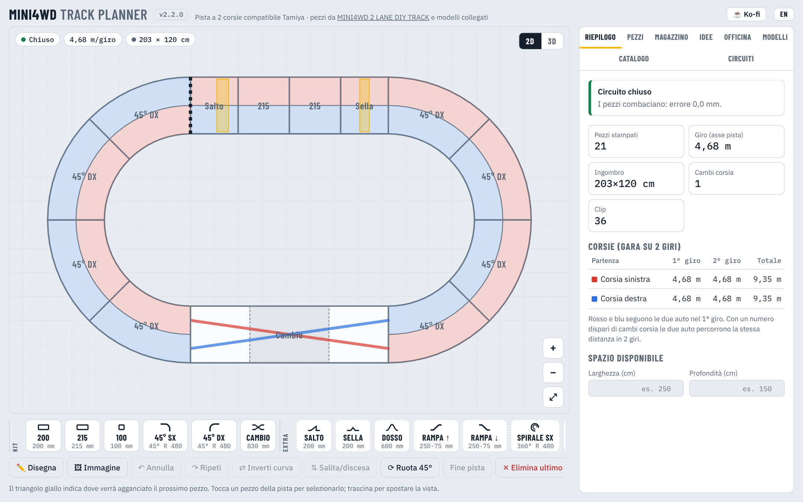

**[⬇ Scarica l'ultima versione](https://github.com/filippocobelli/Mini4WD-Track-Manager/releases/latest)** · macOS (.dmg) · Windows (.exe) · HTML · gratis e open source ([MIT](LICENSE))

[](https://ko-fi.com/filippocobelli)

---

## Perché esiste

Le piste ufficiali Tamiya in Europa sono difficili da trovare e costose da spedire. Per questo esistono
set di pezzi da stampare in 3D, come
[MINI4WD 2 LANE DIY TRACK](https://makerworld.com/en/models/542904-2-lane-mini-4wd-track):
rettilinei, curve da 45°, cambio corsia e clip.

Con i pezzi stampati però le domande diventano altre:

- che circuito posso montare con i pezzi che ho già?
- se ho 3 metri × 2 in garage, che piste ci stanno?
- quanti pezzi devo ancora stampare, e quante ore di stampante sono?
- se aggiungo un salto o una curva sopraelevata, il circuito si chiude ancora?

Track Planner risponde a queste domande prima di accendere la stampante.

## Cosa fa

| | |
|---|---|
| **Pianta 2D** | Componi il circuito pezzo per pezzo, verifica che si chiuda, vedi ingombro e lunghezza del giro. |
| **Disegno o immagine** | Disegna il giro con il mouse o con il dito, oppure carica il disegno di un tracciato: viene ricostruito con i pezzi del kit e chiuso. |
| **Vista 3D** | Ruota il circuito con pareti, cambio corsia sopraelevato, rampe e supporti. |
| **Distinta pezzi** | Pezzi necessari, già in magazzino e da stampare, con ore di stampa e numero di clip. |
| **Magazzino** | Inventario dei pezzi stampati con storico di ogni movimento. |
| **Idee** | Tracciati proposti in base allo spazio libero o ai pezzi che hai, anche in modo casuale con opzioni (salto, scambio, velocità, pista jump…). |
| **Officina** | Motore 3D: crea pezzi da stampare (STL e OBJ) su misura, compatibili con le clip Tamiya. |
| **Modelli** | Altri elementi compatibili trovati su MakerWorld, con link e misure. |

---

## Le sezioni

### Pianta e riepilogo

La barra in basso contiene i pezzi: rettilinei 200 / 215 / 100 mm, curve da 45° a sinistra e a destra,
cambio corsia, più gli **elementi extra**. Il triangolo giallo indica dove verrà agganciato il prossimo pezzo.
Tocca un pezzo della pista per selezionarlo: i nuovi pezzi vengono inseriti subito dopo.

Il **Riepilogo** controlla in continuazione:

- **chiusura**: posizione, direzione e altezza. Se il circuito è aperto, o si chiude solo grazie al gioco delle clip, propone
  correzioni da applicare con un tocco: cambiare, inserire o togliere un pezzo in qualsiasi punto, completare il giro dalla fine, o un pezzo su misura (★);
- **lunghezza delle corsie**: con un numero dispari di cambi corsia le due auto fanno la stessa distanza in 2 giri;
- **ingombro** in cm e se entra nello spazio indicato;
- **altezze**: dislivello da recuperare, quota massima e supporti necessari.

Rosso e blu in pianta seguono il percorso delle due auto nel primo giro.

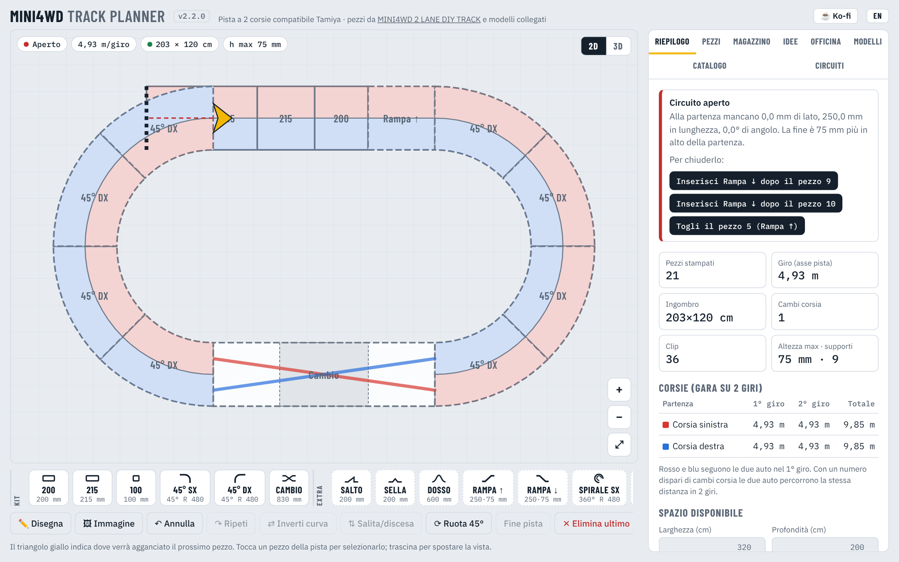

### Sostituire un pezzo

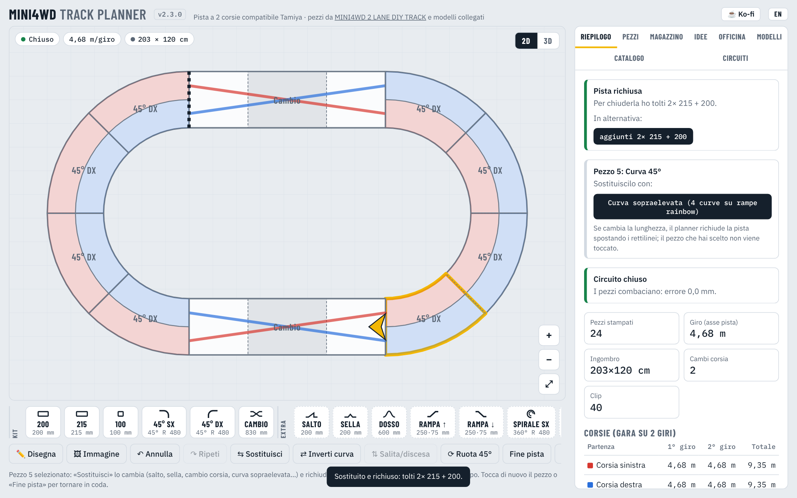

Seleziona un pezzo nella pianta (anche su una pista appena disegnata) e premi **⇆ Sostituisci**:

- un **rettilineo** diventa salto, sella, dosso, wall, cambio corsia o un altro rettilineo;
- una **curva** diventa **sopraelevata**: rampe rainbow prima e dopo tutta la curva (e si può riportare a terra).

Se cambia la lunghezza, il planner richiude la pista da solo: aggiunge o toglie rettilinei lungo una o due direzioni
e non tocca il pezzo che hai scelto. Preferisce mantenere lo stesso ingombro; le altre soluzioni sono a un tocco
nel *Riepilogo*.

Se dopo le tue modifiche la pista resta aperta (per esempio un cambio corsia inserito a mano in una pista disegnata),
**🔁 Richiudi seguendo il disegno** ricostruisce tutta la pista lungo il disegno originale, o lungo la forma attuale,
tenendo i pezzi speciali (cambio corsia, salti, selle, rampe…) più o meno dove li hai messi, e la chiude.

### Da disegno o immagine

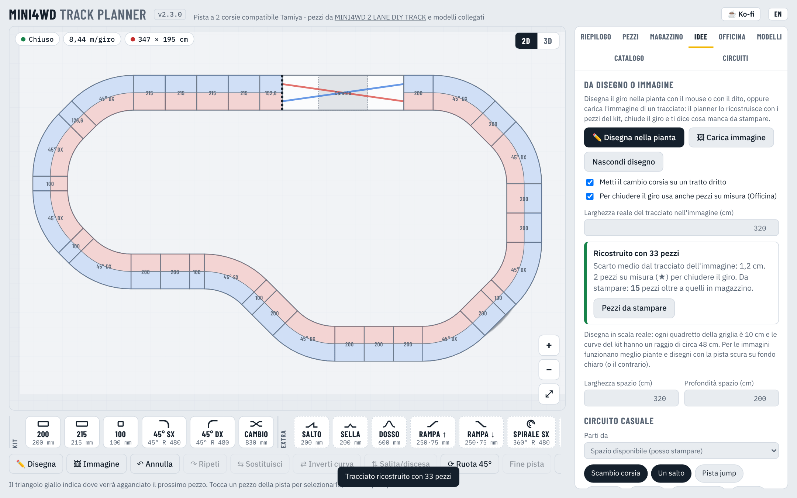

- **🗑 Svuota** libera la pianta (anche l'ovale del kit di partenza); **↶ Annulla** la riporta indietro.
- **✏️ Disegna**: disegna il giro nella pianta con il mouse o con il dito, in scala reale (ogni quadretto è 10 cm).
  Quando alzi il dito il planner lo ricostruisce con i pezzi del kit: rettilinei e curve da 45° che seguono la tua linea,
  il cambio corsia su un tratto dritto e il giro chiuso con precisione.
- **🖼 Immagine**: carica il disegno o la pianta di un tracciato (pista scura su fondo chiaro, o il contrario).
  Il planner trova la linea centrale, la porta alla larghezza reale che indichi e la ricostruisce allo stesso modo;
  l'immagine resta sotto la pianta come guida.
- La scheda *Idee* mostra quanto il risultato si discosta dal disegno e quanti pezzi restano da stampare.

### Vista 3D

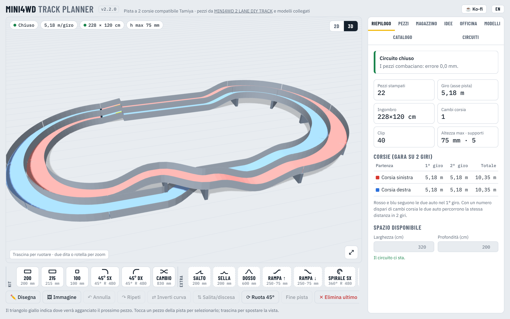

Pulsante **3D** in alto a destra. Trascina per ruotare, rotella o due dita per lo zoom.
Si vedono il ponte del cambio corsia, le parti sollevate, i supporti sotto e i salti.

### Pezzi (distinta)

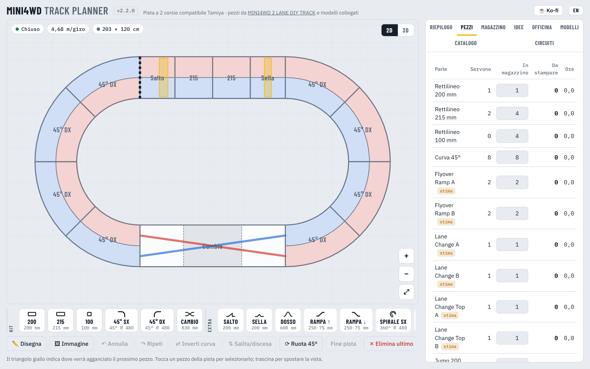

Per ogni parte stampata: quante ne servono, quante ne hai in magazzino, quante da stampare e le ore.
Conta anche le **clip** (2 per giunto, modificabile) e i **supporti** per i tratti rialzati.
Il pulsante **Ho stampato i mancanti** aggiorna il magazzino in un clic.

Per ogni pezzo ancora da stampare ci sono due pulsanti: **MakerWorld** apre il modello originale, **Genera STL** lo crea
nell'Officina con le tue misure. **ZIP STL dei mancanti** scarica solo i pezzi che non hai in magazzino.

### Magazzino

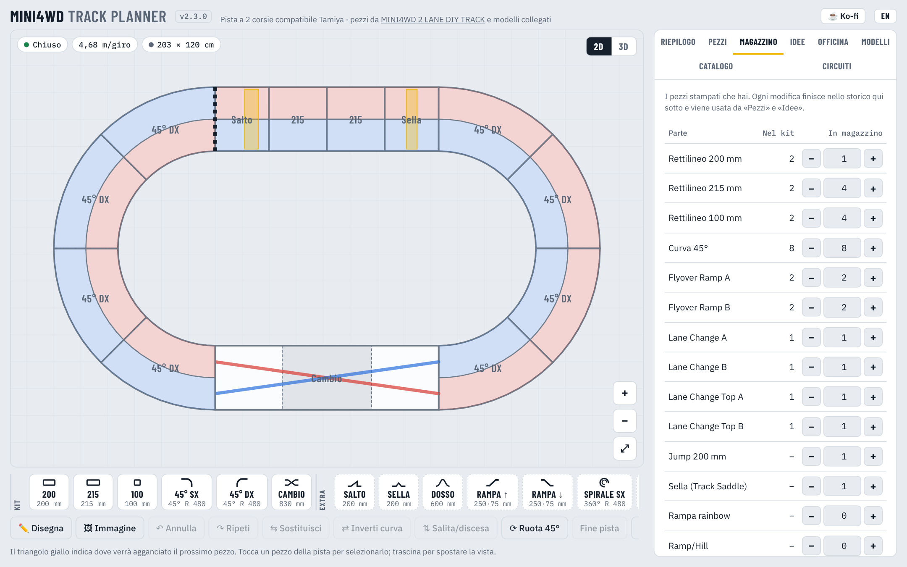

Il magazzino è l'elenco dei pezzi che hai già stampato.

- Aggiungi o togli pezzi con **+** e **−**, o scrivi direttamente la quantità.
- **+ 1 kit base completo** carica in un colpo tutti i pezzi del set (8 curve, 2+2+2 rettilinei, cambio corsia).
- Ogni modifica finisce nello **storico** con data, quantità e motivo (kit, stampati per un circuito, modifica manuale…).
  Così sai cosa hai stampato e quando, e cosa si è rotto.

Il magazzino è usato dalla distinta (colonna *In magazzino*) e da tutti i generatori di tracciati.

### Idee: tracciati generati

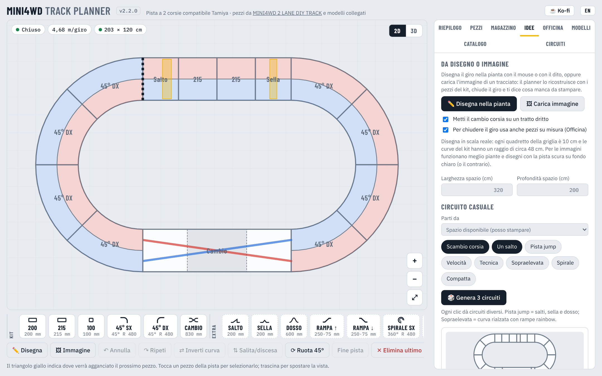

Inserisci **larghezza e profondità** dello spazio libero, poi scegli da cosa partire:

| Parti da | Cosa ottieni |
|---|---|
| **Spazio disponibile** | circuiti che entrano nello spazio; possono richiedere pezzi da stampare |
| **Solo pezzi in magazzino** | circuiti montabili subito, senza stampare nulla |
| **Pezzi in magazzino + spazio** | entrambe le condizioni |

Poi attiva cosa vuoi nel circuito:

| Opzione | Effetto |
|---|---|
| **Scambio corsia** | inserisce il cambio corsia, per gare alla pari |
| **Un salto** | un rettilineo Jump |
| **Pista jump** | salti, sella e dosso |
| **Velocità** | lati lunghi e poche curve |
| **Tecnica** | chicane, fagioli, piste a L, tante curve |
| **Sopraelevata** | una curva a 180° rialzata con le rampe rainbow |
| **Spirale** | una salita e una discesa a spirale |
| **Compatta** | il minor ingombro possibile |

**🎲 Genera 3 circuiti** propone ogni volta tre tracciati diversi (ovale, rettangolo, ottagono, ovale con chicane,
fagiolo, pista a L). Ogni proposta è verificata: si chiude, torna alla quota di partenza ed entra nello spazio.
Per ognuna vedi anteprima, ingombro, giro, **pezzi che hai** e **pezzi da stampare** con le ore stimate.
**Usa questo tracciato** lo apre nella pianta per modificarlo.

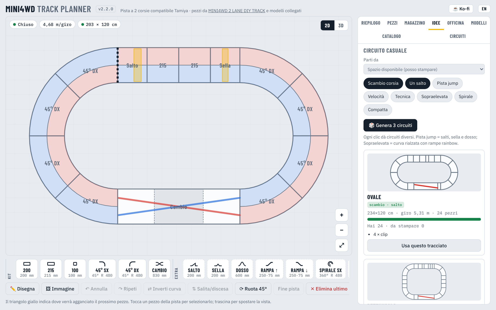

**Alternative ordinate** fa la stessa ricerca in modo sistematico: per ovali, rettangoli e ottagoni mostra
il più economico (pochi pezzi da stampare), il più lungo con poche stampe e il più lungo che ci sta.

### Officina: pezzi 3D su misura

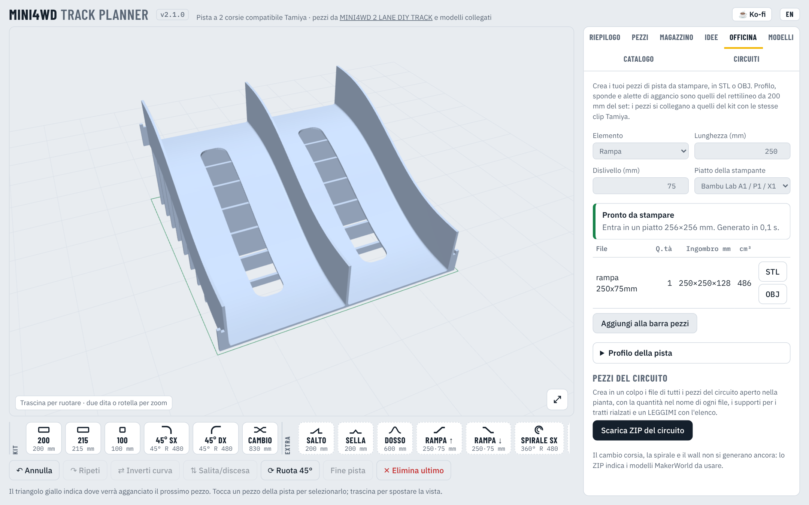

Dalla versione 2.0 il planner ha un **motore 3D** che genera pezzi di pista pronti da stampare, in **STL** o **OBJ**.
Così non sei limitato ai modelli che trovi in rete: lunghezze, angoli, raggi e altezze li decidi tu.

| Elemento | Parametri |
|---|---|
| **Rettilineo** | lunghezza |
| **Curva** | angolo e raggio in asse |
| **Rampa** | lunghezza e dislivello, con raccordi dolci alle estremità |
| **Dosso** | lunghezza e altezza |
| **Salto** | rampa di lancio dentro ogni corsia: lunghezza e altezza |
| **Sella** | rilievo a triangolo dentro ogni corsia |
| **Washboard** | serie di piccoli dossi |
| **Supporto rialzo** | appoggio per i tratti sollevati, alto quanto serve |

Il profilo di partenza è misurato sul rettilineo da 200 mm del set (corsie da 115 mm, pareti e pavimento da 2,5 mm,
sponde da 50 mm, raccordi, asole e **alette di aggancio Tamiya**): il rettilineo da 200 generato coincide con l'originale
(250,3 × 200 × 52,5 mm, 178,9 cm³). I pezzi nuovi si collegano a quelli del kit con le stesse clip.

- **Piatto della stampante**: scegli il tuo (Bambu Lab, Prusa, Creality…). Se un pezzo non entra viene ruotato
  o **diviso in parti uguali**, ognuna con le sue alette (es. una curva 45° R480 diventa 2 × 22,5°).
- **Profilo della pista**: corsia, pareti, pavimento, sponde, raccordi, alette, asole e nervature sono modificabili.
- **Aggiungi alla barra pezzi**: il pezzo creato entra nel planner (gruppo *Miei*) e si usa nei circuiti.
- **Scarica ZIP del circuito**: tutti i pezzi del circuito aperto, con la quantità nel nome del file,
  i supporti per i tratti rialzati e un LEGGIMI con l'elenco. Il cambio corsia, la spirale e il wall non si generano ancora:
  il LEGGIMI indica il modello MakerWorld da usare.

I solidi sono creati con [Manifold](https://github.com/elalish/manifold) (Apache-2.0), che garantisce pezzi chiusi e stampabili.

### Modelli ed elementi extra

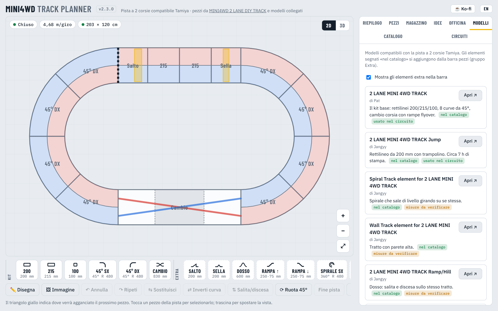

Oltre al kit base, il planner conosce questi elementi compatibili con la pista Tamiya a 2 corsie:

| Elemento | Modello | Note |
|---|---|---|
| Rettilineo 200 / 215 / 100, curva 45°, cambio corsia | [2 LANE MINI 4WD TRACK](https://makerworld.com/en/models/542904-2-lane-mini-4wd-track) – Pat | kit base |
| Salto 200 mm | [Jump](https://makerworld.com/en/models/1373681-2-lane-mini-4wd-track-jump) – Jangyy | ~7 h di stampa |
| Spirale | [Spiral Track element](https://makerworld.com/en/models/1395843-spiral-track-element-for-2-lane-mini-4wd-track) – Jangyy | misure da verificare |
| Wall | [Wall Track element](https://makerworld.com/en/models/1418601-wall-track-element-for-2-lane-mini-4wd-track) – Jangyy | misure da verificare |
| Dosso | 2 LANE MINI 4WD TRACK Ramp/Hill – Jangyy | misure da verificare |
| Rampa rainbow | [Tamiya rainbow track 2 lane](https://makerworld.com/en/models/1336265-tamiya-rainbow-track-2-lane-no-change-lane) – Sunza83 | rampe e supporti |
| Sella | [Mini 4WD Track Saddle](https://makerworld.com/en/models/734281-mini-4wd-track-saddle) | 4,6 h di stampa |
| Rettilineo modulare 240 | [Modular Mini4wd 240mm track set](https://makerworld.com/en/models/248350-modular-mini4wd-240mm-track-set-1) – rucdoc | per stampanti piccole |
| Curve di altri raggi | [Single Lane Curve pack](https://makerworld.com/en/models/1132759-mini4wd-single-lane-curve-track-pack) – rucdoc | da aggiungere come pezzo personalizzato |

L'app contiene solo i link: i file STL si scaricano da MakerWorld, con le licenze dei rispettivi autori.

### Catalogo

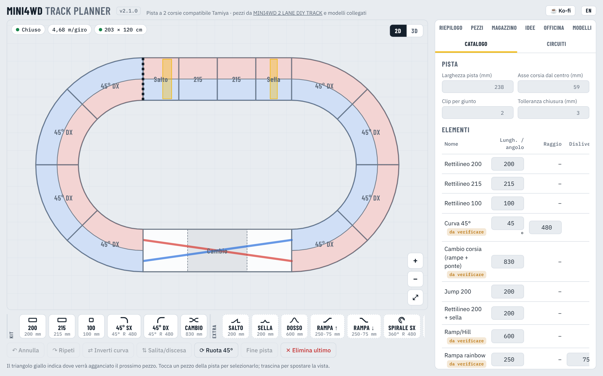

Tutte le misure sono modificabili: larghezza pista, raggio delle curve, lunghezza del cambio corsia,
dislivello delle rampe, quantità nel kit e ore di stampa per pezzo. Puoi aggiungere **pezzi personalizzati**
(rettilinei o curve di qualsiasi angolo e raggio) che compaiono nella barra come gruppo *Miei*.

> Il raggio delle curve (480 mm in asse) e la lunghezza del cambio corsia (830 mm) sono stimati dall'ovale
> Tamiya 216 × 120 cm. Misurali sui tuoi pezzi e correggili qui: tutti i calcoli si aggiornano.

### Circuiti

Circuiti pronti (ovale del kit, ovale lungo, rettangolo, ovale con salto e sella, ovale con rainbow),
esportazione e importazione in JSON (circuito + magazzino + storico) e copia della pianta in SVG.

### Lingua

L'app parte in inglese. Il pulsante **IT / EN** in alto a destra passa all'italiano e ricorda la scelta.

### Da telefono

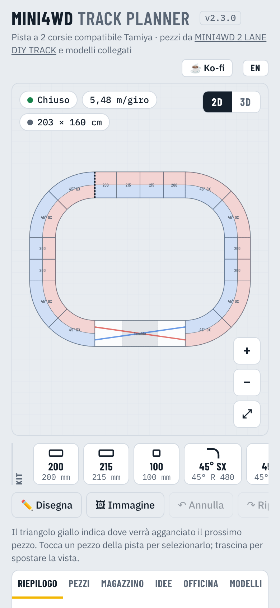

La versione HTML funziona anche su telefono: pianta con pan e zoom a due dita, barra pezzi scorrevole.

---

## Download e installazione

Ogni versione è nella pagina **[Releases](https://github.com/filippocobelli/Mini4WD-Track-Manager/releases)**:

| File | Per |
|---|---|
| `Mini4WD-Track-Planner-<versione>-mac-universal.dmg` | macOS (Intel e Apple Silicon) |
| `Mini4WD-Track-Planner-<versione>-win-setup.exe` | Windows, con installazione |
| `Mini4WD-Track-Planner-<versione>-win-portable.exe` | Windows, senza installazione |
| `Mini4WD-Track-Planner-v<versione>.html` | qualsiasi browser o sito statico |

Versione web sempre aggiornata: **[lab.cobelli.uk/Mini4WD-Track-Manager/app](https://lab.cobelli.uk/Mini4WD-Track-Manager/app/)** · pagina del progetto: [lab.cobelli.uk/Mini4WD-Track-Manager](https://lab.cobelli.uk/Mini4WD-Track-Manager/it/).

Le app desktop funzionano offline. Non hanno la firma a pagamento di Apple e Microsoft:
- **macOS**: al primo avvio, tasto destro sull'app → *Apri*. Se macOS la blocca: *Impostazioni di Sistema → Privacy e sicurezza → Apri comunque*.
  Se compare «è danneggiata e non può essere aperta», apri il Terminale e scrivi
  `xattr -cr "/Applications/Mini4WD Track Planner.app"`, poi riaprila.
- **Windows**: se compare SmartScreen, *Ulteriori informazioni → Esegui comunque*.

I dati (circuito, magazzino, storico) restano sul dispositivo. Per spostarli: *Circuiti → Copia JSON* e *Carica JSON*.

---

## Partecipa

Mini4WD Track Planner è un progetto della community: chiunque può proporre modifiche.

- **Non programmi?** Segnala un problema, proponi un'idea o mandaci le **misure reali** dei pezzi stampati
  (raggio delle curve, lunghezza del cambio corsia): apri una [issue](../../issues/new/choose).
- **Programmi?** Fai un fork, sviluppa la modifica e apri una **pull request**. I test automatici girano su ogni proposta;
  se va bene entra nella versione successiva. Tutto è spiegato in **[CONTRIBUTING.md](CONTRIBUTING.md)** (in inglese).

Il codice scritto con strumenti AI è benvenuto, purché chi lo propone l'abbia letto e provato.

## Sostieni il progetto

Il planner è gratis e lo resterà. Se ti è utile puoi offrirmi un caffè su **[Ko-fi](https://ko-fi.com/filippocobelli)** ☕

## Sviluppo

```
app/                 sorgente unico (index.html, icone, manifest)
app/engine3d.js      motore 3D: genera i pezzi STL/OBJ
app/trace.js         chiusura del giro, ricostruzione da disegno e da immagine
app/vendor/          Manifold (WASM), preparato da npm run vendor
tests/               test automatici
electron/main.js     finestra dell'app desktop
site/                pagina del progetto su lab.cobelli.uk (EN + it/)
scripts/build.mjs    genera dist/web/*.html (file unico) e desktop/ (versione offline)
build/icon.png       icona delle app desktop
docs/screenshots/    immagini dei README (it/ per la versione italiana)
.github/workflows/   build e release automatiche
```

```bash
npm install
npm test             # build + test automatici (motore 3D e app)
npm start            # apre l'app desktop
npm run build:web    # crea il file HTML unico in dist/web/
npm run vendor       # aggiorna Manifold in app/vendor/ (solo quando cambia versione)
```

I testi dell'interfaccia sono in `app/index.html` come coppie `L("italiano", "English")` e in `app/engine3d.js` come `tr(...)`.
Quando aggiungi un testo, scrivilo in entrambe le lingue.

### Versioni e release

Ogni build ha un numero di versione `MAJOR.MINOR.PATCH`, visibile accanto al titolo dell'app.

1. Aggiungi la sezione della nuova versione in `CHANGELOG.md`.
2. `npm version patch` (oppure `minor` / `major`): aggiorna `package.json` e `app/index.html` e crea il commit.
3. `git push`

Quando su `main` arriva una versione non ancora rilasciata, GitHub Actions costruisce `.dmg` ed `.exe`,
crea il tag `vX.Y.Z` e la Release con anche il file HTML. Il workflow si ferma se `package.json`,
`app/index.html` e `CHANGELOG.md` non hanno la stessa versione.

## Licenza

Codice rilasciato con licenza **[MIT](LICENSE)**: puoi usarlo, modificarlo e ridistribuirlo liberamente,
anche in altri progetti, mantenendo la nota di copyright.

La licenza riguarda solo il codice di questa app. I modelli 3D dei pezzi (MakerWorld e altri siti)
appartengono ai rispettivi autori e seguono le loro licenze: l'app contiene solo i link.
