# Mini4WD Track Planner

**English** · [Italiano](README.it.md)

Design Tamiya-compatible **2-lane Mini4WD tracks** built from 3D-printed pieces, and see right away
how many pieces you need, which ones you already have and how much printing time is left.

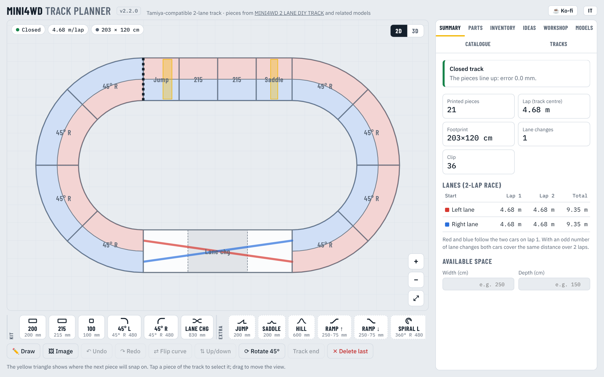

**[⬇ Download the latest version](https://github.com/filippocobelli/Mini4WD-Track-Manager/releases/latest)** · macOS (.dmg) · Windows (.exe) · HTML · free and open source ([MIT](LICENSE))

[](https://ko-fi.com/filippocobelli)

---

## Why it exists

Official Tamiya tracks are hard to find in Europe and expensive to ship. That's why there are
sets of pieces you can 3D print, like
[MINI4WD 2 LANE DIY TRACK](https://makerworld.com/en/models/542904-2-lane-mini-4wd-track):
straights, 45° curves, lane change and clips.

Once you print your own pieces, the questions change:

- what track can I build with the pieces I already have?
- if I have 3 × 2 metres in the garage, which tracks fit?
- how many pieces do I still have to print, and how many printer hours is that?
- if I add a jump or a raised turn, does the track still close?

Track Planner answers these questions before you switch the printer on.

## What it does

| | |
|---|---|
| **2D plan** | Build the track piece by piece, check that it closes, see the footprint and the lap length. |
| **Draw or upload a picture** | Draw the lap with the mouse or a finger, or upload a drawing of a layout: it is rebuilt with kit pieces and closed. |
| **3D view** | Rotate the track with walls, raised lane change, ramps and supports. |
| **Parts list** | Pieces needed, already in stock and to print, with print hours and number of clips. |
| **Inventory** | List of your printed pieces with a history of every change. |
| **Ideas** | Layouts suggested for your free space or the pieces you own, also at random with options (jump, lane change, speed, jump track…). |
| **Workshop** | 3D engine: makes custom printable pieces (STL and OBJ) that work with Tamiya clips. |
| **Models** | Other compatible elements found on MakerWorld, with links and sizes. |

The app is in English and Italian: the **IT / EN** button at the top right switches language and remembers your choice.

---

## The sections

### Plan and summary

The bar at the bottom holds the pieces: 200 / 215 / 100 mm straights, 45° curves to the left and right,
lane change, plus the **extra elements**. The yellow triangle shows where the next piece will snap on.
Tap a piece of the track to select it: new pieces are inserted right after it.

The **Summary** keeps checking:

- **closing**: position, heading and height. If the track is open, or closes only thanks to the play in the clips, it proposes
  fixes you apply with one tap: swap, insert or remove one piece anywhere, complete the loop from the end, or a made-to-measure piece (★);
- **lane length**: with an odd number of lane changes both cars cover the same distance over 2 laps;
- **footprint** in cm and whether it fits the space you entered;
- **heights**: rise left to recover, maximum height and supports needed.

Red and blue in the plan follow the path of the two cars on the first lap.

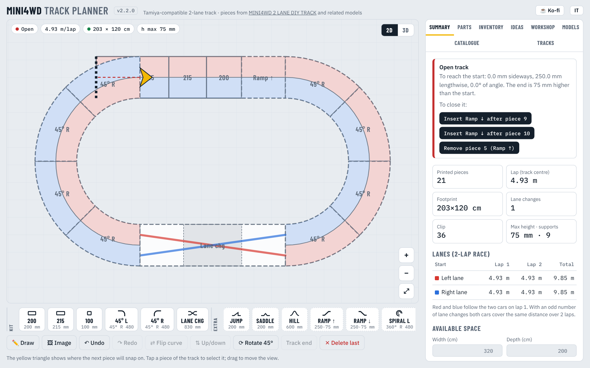

### Swap a piece

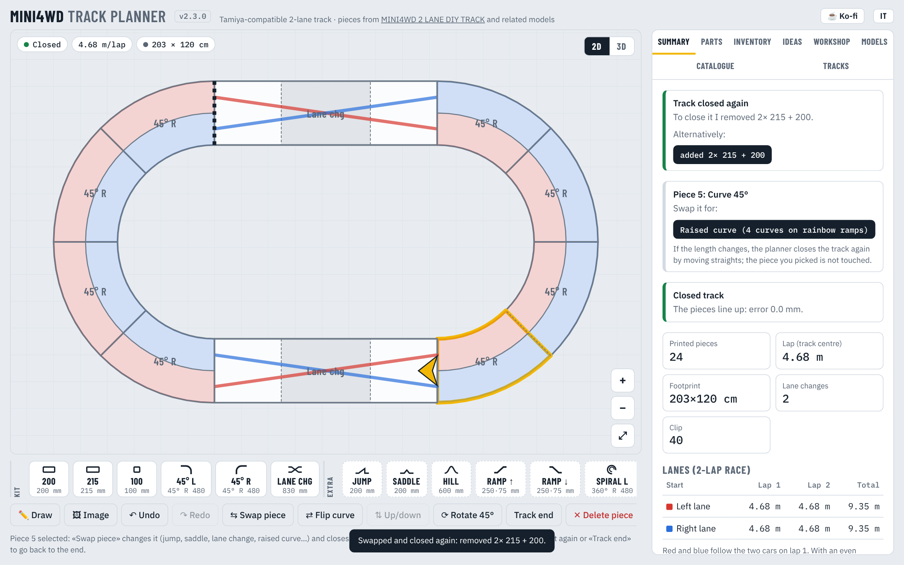

Select a piece in the plan (also on a track you have just drawn) and press **⇆ Swap piece**:

- a **straight** becomes a jump, a saddle, a hill, a wall, the lane change or another straight;
- a **curve** becomes a **raised curve**: rainbow ramps before and after the whole turn (and back to the ground).

If the length changes, the planner closes the track again by itself: it adds or removes straights along one or two
directions and never touches the piece you chose. It prefers keeping the same footprint; the other solutions are
one tap away in *Summary*.

If the track ends up open after your changes (for example a lane change inserted by hand in a drawn track),
**🔁 Close it following the drawing** rebuilds the whole track along the original drawing, or along its current shape,
keeping the special pieces (lane change, jumps, saddles, ramps…) roughly where you put them, and closes it.

### From a drawing or an image

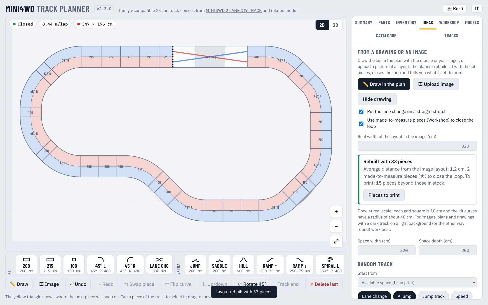

- **🗑 Clear** empties the plan first (the starting kit oval too); **↶ Undo** brings it back.
- **✏️ Draw**: draw the lap in the plan with the mouse or a finger, at any size: if its bends are tighter than the kit
  curves (radius 48 cm) the drawing is enlarged as needed, and stays under the track scaled the same way.
  When you lift your finger the planner rebuilds it with kit pieces: straights and 45° curves that follow your line,
  the lane change on a straight stretch, and the loop closed exactly.
- **🖼 Image**: upload a drawing, a plan or an export from an online track editor. The planner finds the track's centre
  line (also through crossings and bridges), measures the track width and counts the lanes to get the **real scale**
  (a 3-lane Tamiya layout is rebuilt at its real size as a 2-lane track), or uses the width you enter;
  the picture stays under the plan as a guide. Crossings are flagged: they need a bridge.
- The *Ideas* tab shows how far the result is from the drawing and how many pieces are left to print.

### 3D view

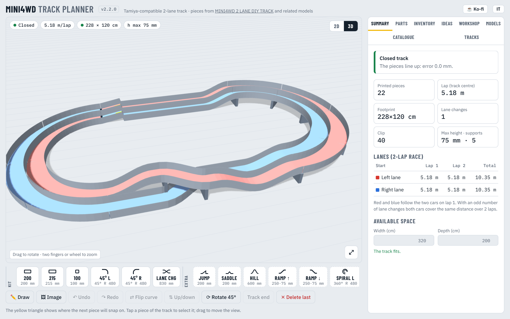

**3D** button at the top right. Drag to rotate, wheel or two fingers to zoom.
You can see the lane change bridge, the raised parts, the supports underneath and the jumps.

### Parts

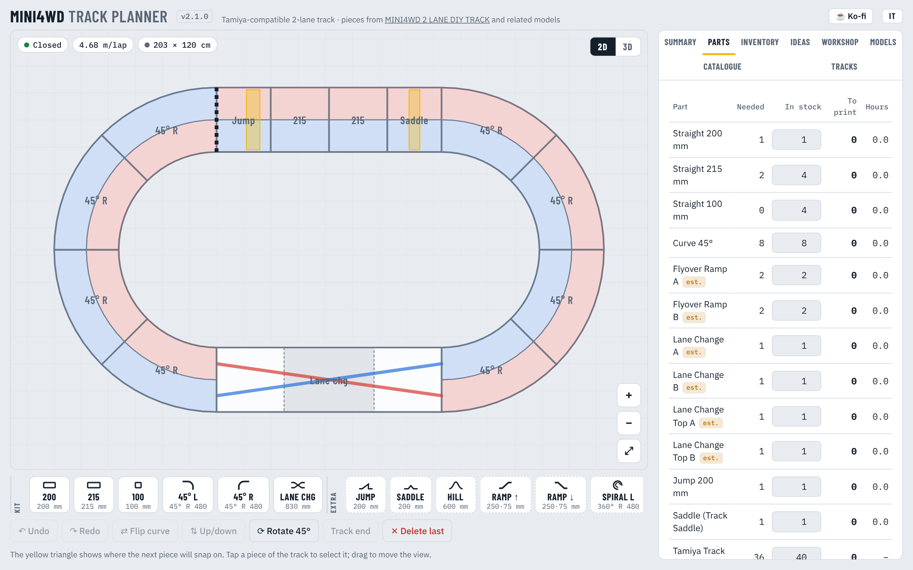

For every printed part: how many you need, how many you have in stock, how many to print and the hours.
It also counts the **clips** (2 per joint, editable) and the **supports** for raised sections.
The **I printed the missing ones** button updates the inventory in one click.

For every piece still to print there are two buttons: **MakerWorld** opens the original model, **Make STL** builds it in the
Workshop with your sizes. **STL ZIP of the missing ones** downloads only the pieces you don't have in stock.

### Inventory

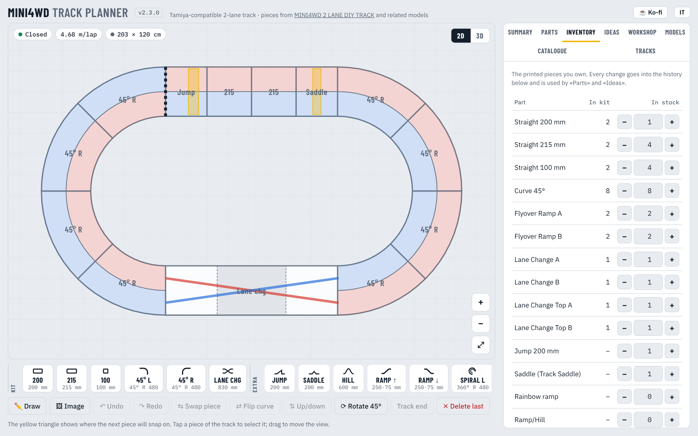

The inventory is the list of pieces you have already printed.

- Add or remove pieces with **+** and **−**, or type the quantity.
- **+ 1 full base kit** adds every piece of the set in one go (8 curves, 2+2+2 straights, lane change).
- Every change goes into the **history** with date, quantity and reason (kit, printed for a track, manual change…).
  So you know what you printed and when, and what broke.

The inventory is used by the parts list (*In stock* column) and by every layout generator.

### Ideas: generated layouts

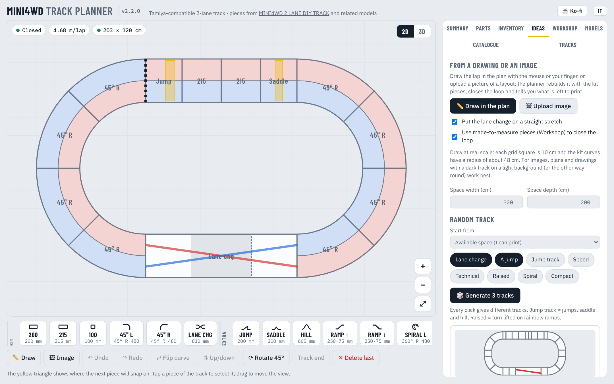

Enter the **width and depth** of your free space, then choose what to start from:

| Start from | What you get |
|---|---|
| **Available space** | tracks that fit the space; they may need pieces to print |
| **Only pieces in stock** | tracks you can build right now, without printing anything |
| **Pieces in stock + space** | both conditions |

Then pick what you want in the track:

| Option | Effect |
|---|---|
| **Lane change** | adds the lane change, for fair races |
| **A jump** | a Jump straight |
| **Jump track** | jumps, saddle and hill |
| **Speed** | long sides and few curves |
| **Technical** | chicanes, bean and L shapes, lots of curves |
| **Raised** | a 180° turn lifted on the rainbow ramps |
| **Spiral** | a spiral climb and descent |
| **Compact** | the smallest footprint possible |

**🎲 Generate 3 tracks** gives three different layouts every time (oval, rectangle, octagon, oval with chicane,
bean, L-shaped track). Every suggestion is checked: it closes, comes back to the starting height and fits the space.
For each one you see a preview, footprint, lap, **pieces you have** and **pieces to print** with the estimated hours.
**Use this layout** opens it in the plan so you can edit it.

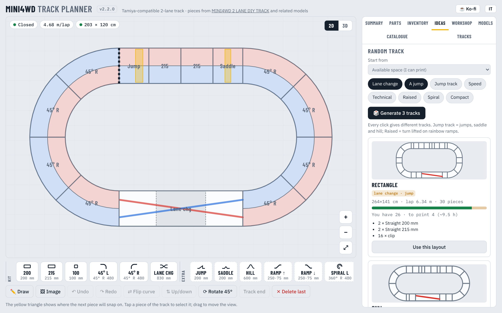

**Sorted alternatives** runs the same search systematically: for ovals, rectangles and octagons it shows
the cheapest (fewest pieces to print), the longest with few prints and the longest that fits.

### Workshop: custom 3D pieces

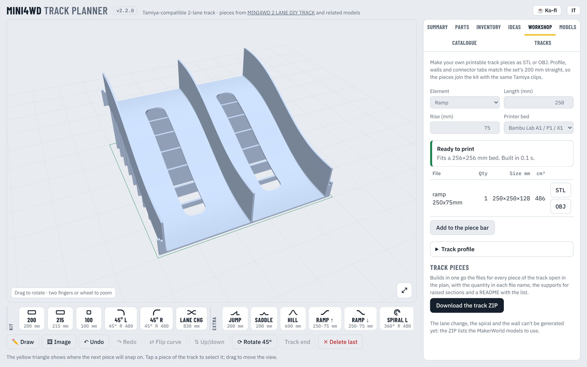

Since version 2.0 the planner has a **3D engine** that generates ready-to-print track pieces as **STL** or **OBJ**.
So you're not limited to the models you find online: you choose lengths, angles, radii and heights.

| Element | Parameters |
|---|---|
| **Straight** | length |
| **Curve** | angle and centre-line radius |
| **Ramp** | length and rise, with smooth transitions at the ends |
| **Hill** | length and height |
| **Jump** | kicker ramp inside each lane: length and height |
| **Saddle** | triangular bump inside each lane |
| **Washboard** | a series of small bumps |
| **Raised support** | stand for raised sections, as tall as needed |

The starting profile is measured on the set's 200 mm straight (115 mm lanes, 2.5 mm walls and floor,
50 mm walls, fillets, slots and **Tamiya connector tabs**): the generated 200 mm straight matches the original
(250.3 × 200 × 52.5 mm, 178.9 cm³). New pieces join the kit with the same clips.

- **Printer bed**: pick yours (Bambu Lab, Prusa, Creality…). If a piece doesn't fit it is rotated
  or **split into equal parts**, each with its own tabs (e.g. a 45° R480 curve becomes 2 × 22.5°).
- **Track profile**: lane, walls, floor, wall height, fillets, tabs, slots and ribs can all be changed.
- **Add to the piece bar**: the new piece goes into the planner (*Mine* group) and can be used in tracks.
- **Download the track ZIP**: every piece of the open track, with the quantity in the file name,
  the supports for raised sections and a README with the list. The lane change, the spiral and the wall can't be
  generated yet: the README names the MakerWorld model to use.

The solids are made with [Manifold](https://github.com/elalish/manifold) (Apache-2.0), which guarantees closed, printable pieces.

### Models and extra elements

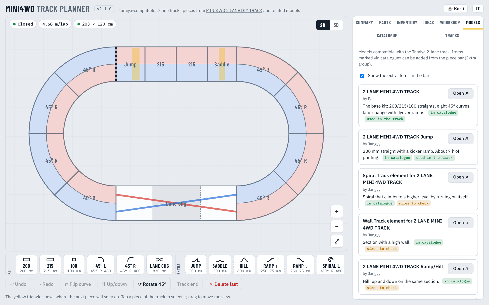

Besides the base kit, the planner knows these elements compatible with the Tamiya 2-lane track:

| Element | Model | Notes |
|---|---|---|
| 200 / 215 / 100 straights, 45° curve, lane change | [2 LANE MINI 4WD TRACK](https://makerworld.com/en/models/542904-2-lane-mini-4wd-track) – Pat | base kit |
| 200 mm jump | [Jump](https://makerworld.com/en/models/1373681-2-lane-mini-4wd-track-jump) – Jangyy | ~7 h of printing |
| Spiral | [Spiral Track element](https://makerworld.com/en/models/1395843-spiral-track-element-for-2-lane-mini-4wd-track) – Jangyy | sizes to check |
| Wall | [Wall Track element](https://makerworld.com/en/models/1418601-wall-track-element-for-2-lane-mini-4wd-track) – Jangyy | sizes to check |
| Hill | 2 LANE MINI 4WD TRACK Ramp/Hill – Jangyy | sizes to check |
| Rainbow ramp | [Tamiya rainbow track 2 lane](https://makerworld.com/en/models/1336265-tamiya-rainbow-track-2-lane-no-change-lane) – Sunza83 | ramps and supports |
| Saddle | [Mini 4WD Track Saddle](https://makerworld.com/en/models/734281-mini-4wd-track-saddle) | 4.6 h of printing |
| Modular 240 straight | [Modular Mini4wd 240mm track set](https://makerworld.com/en/models/248350-modular-mini4wd-240mm-track-set-1) – rucdoc | for small printers |
| Curves with other radii | [Single Lane Curve pack](https://makerworld.com/en/models/1132759-mini4wd-single-lane-curve-track-pack) – rucdoc | add them as a custom piece |

The app only holds the links: the STL files are downloaded from MakerWorld, under their authors' licences.

### Catalogue

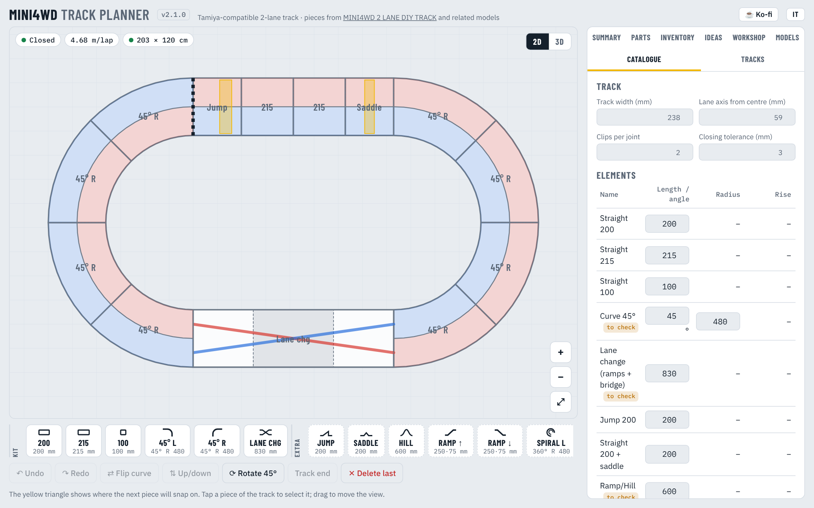

Every size can be changed: track width, curve radius, lane change length, ramp rise,
quantity in the kit and print hours per piece. You can add **custom pieces**
(straights or curves of any angle and radius) that show up in the bar as the *Mine* group.

> The curve radius (480 mm on the centre line) and the lane change length (830 mm) are estimated from the
> 216 × 120 cm Tamiya oval. Measure your pieces and fix them here: every calculation updates.

### Tracks

Ready-made tracks (kit oval, long oval, rectangle, oval with jump and saddle, rainbow oval),
JSON export and import (track + inventory + history) and copying the plan as SVG.

### On a phone


The HTML version also works on phones: plan with two-finger pan and zoom, scrolling piece bar.

---

## Download and install

Every version is on the **[Releases](https://github.com/filippocobelli/Mini4WD-Track-Manager/releases)** page:

| File | For |
|---|---|
| `Mini4WD-Track-Planner-<version>-mac-universal.dmg` | macOS (Intel and Apple Silicon) |
| `Mini4WD-Track-Planner-<version>-win-setup.exe` | Windows, with installer |
| `Mini4WD-Track-Planner-<version>-win-portable.exe` | Windows, no install |
| `Mini4WD-Track-Planner-v<version>.html` | any browser or static site |

Always up-to-date web version: **[lab.cobelli.uk/Mini4WD-Track-Manager/app](https://lab.cobelli.uk/Mini4WD-Track-Manager/app/)** · project page: [lab.cobelli.uk/Mini4WD-Track-Manager](https://lab.cobelli.uk/Mini4WD-Track-Manager/).

The desktop apps work offline. They don't have Apple's or Microsoft's paid signature:
- **macOS**: on first launch, right-click the app → *Open*. If macOS blocks it: *System Settings → Privacy & Security → Open Anyway*.
  If you see "is damaged and can't be opened", open Terminal and type
  `xattr -cr "/Applications/Mini4WD Track Planner.app"`, then open it again.
- **Windows**: if SmartScreen appears, *More info → Run anyway*.

Your data (track, inventory, history) stays on your device. To move it: *Tracks → Copy JSON* and *Load JSON*.

---

## Contribute

Mini4WD Track Planner is a community project: anyone can suggest changes.

- **Not a programmer?** Report a problem, suggest an idea or send us the **real sizes** of your printed pieces
  (curve radius, lane change length): open an [issue](../../issues/new/choose).
- **A programmer?** Fork, make your change and open a **pull request**. Automated tests run on every proposal;
  if it's good it goes into the next version. Everything is explained in **[CONTRIBUTING.md](CONTRIBUTING.md)**.

Code written with AI tools is welcome, as long as whoever proposes it has read and tested it.

## Support the project

The planner is free and will stay free. If you find it useful you can buy me a coffee on **[Ko-fi](https://ko-fi.com/filippocobelli)** ☕

## Development

```
app/                 single source (index.html, icons, manifest)
app/engine3d.js      3D engine: builds the STL/OBJ pieces
app/trace.js         closing solver, sketch fitting and image tracing
app/vendor/          Manifold (WASM), prepared by npm run vendor
tests/               automated tests
electron/main.js     desktop app window
site/                project page on lab.cobelli.uk (EN + it/)
scripts/build.mjs    builds dist/web/*.html (single file) and desktop/ (offline version)
build/icon.png       desktop app icon
docs/screenshots/    README images (it/ for the Italian version)
.github/workflows/   automated builds and releases
```

```bash
npm install
npm test             # build + automated tests (3D engine and app)
npm start            # opens the desktop app
npm run build:web    # creates the single HTML file in dist/web/
npm run vendor       # updates Manifold in app/vendor/ (only when its version changes)
```

User-facing text lives in `app/index.html` as `L("italiano", "English")` pairs, and in `app/engine3d.js` as `tr(...)`.
Please add both languages when you add text.

### Versions and releases

Every build has a `MAJOR.MINOR.PATCH` version number, shown next to the app title.

1. Add the new version's section to `CHANGELOG.md`.
2. `npm version patch` (or `minor` / `major`): updates `package.json` and `app/index.html` and makes the commit.
3. `git push`

When `main` gets a version that hasn't been released yet, GitHub Actions builds the `.dmg` and `.exe`,
creates the `vX.Y.Z` tag and the Release, with the HTML file too. The workflow stops if `package.json`,
`app/index.html` and `CHANGELOG.md` don't have the same version.

## Licence

Code released under the **[MIT](LICENSE)** licence: you can use, change and redistribute it freely,
in other projects too, as long as you keep the copyright notice.

The licence only covers this app's code. The 3D models of the pieces (MakerWorld and other sites)
belong to their authors and follow their licences: the app only holds the links.
